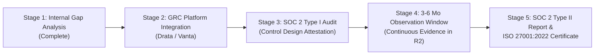

# Pocket365 Information Security Management System (ISMS) & Audit Readiness Guide
## SOC 2 Type II & ISO/IEC 27001:2022 Implementation Specification

---

## 1. Executive Summary & Scope

This document defines the Information Security Management System (ISMS) and internal control baseline for **Pocket365** (`pocket365`), operating in both **Self-Hosted** and **Multi-Tenant SaaS** deployment modes.

- **System Description:** Cloudflare-native Microsoft 365 & Microsoft Entra ID security posture assessment, governance console, and automated remediation engine.
- **In-Scope Runtime Infrastructure:**
  - Cloudflare Workers edge runtime (`workerd` + `nodejs_compat`)
  - Cloudflare D1 distributed edge database (`pocket365-db`)
  - Cloudflare KV distributed cache & sliding rate-limiter (`POCKET365_KV`)
  - Cloudflare R2 audit report & compliance artifact archive (`POCKET365_R2`)
  - Cloudflare Cron Triggers (`*/15 * * * *`) & Queues
  - GitHub Actions CI/CD quality gate & GitHub source code repository
- **Compliance Frameworks:**
  - **AICPA SOC 2 Type II:** Trust Services Criteria (Common Criteria CC1.0 through CC9.0)
  - **ISO/IEC 27001:2022:** Information Security, Cybersecurity and Privacy Protection (Clauses 4–10 & Annex A Controls)

---

## 2. Shared Responsibility Model & Inherited Controls

Because Pocket365 runs 100% on Cloudflare's serverless Full Stack without self-managed virtual machines, operating system kernels, or physical data centers, **Pocket365 directly inherits Cloudflare's independent third-party certifications**:
- **ISO/IEC 27001:2022, ISO/IEC 27701:2019, ISO 27018**
- **SOC 2 Type II (Security, Availability, Confidentiality)**
- **PCI-DSS Level 1 Service Provider**

### Responsibility Matrix:
| Security Layer | Responsible Party | Verification & Evidence |
| :--- | :--- | :--- |
| **Physical Data Center Security** | Cloudflare | Cloudflare SOC 2 Type II Report & ISO 27001 Certificate |
| **Hypervisor & Network Hardware** | Cloudflare | Annual Cloudflare third-party penetration testing |
| **DDoS & Web Application Firewall** | Cloudflare | Cloudflare Edge Protection & Layer 7 rate-limiting |
| **Serverless Runtime Sandboxing** | Cloudflare (`workerd` V8 isolates) | Isolated memory execution with zero cross-isolate leakage |
| **Application Logic & RBAC** | **Pocket365 Application** | 5-tier server-side RBAC guards (`src/server/auth/roles.ts`) |
| **Cryptographic Storage & Keys** | **Pocket365 Application** | Key-versioned AES-256-GCM (`enc:v2:...`), zero cleartext secrets |
| **Tenant & Organization Isolation**| **Pocket365 Application** | D1 `organization_id` row-scoping & R2 path isolation |
| **Target M365 Tenant Security** | **Customer / MSP Administrator** | Pocket365 CIS, NIST, SOC 2, and ISO 27001 Benchmark checks |

---

## 3. Core Technical Security Policies

### POL-01: Logical Access Control, MFA & Identity Governance
* **Standards:** SOC 2 CC6.1, CC6.2, CC6.3; ISO/IEC 27001:2022 A.5.15, A.5.16, A.5.17, A.5.18, A.8.2, A.8.5
1. **Authentication:** All authentication into Pocket365 requires Microsoft Entra ID OIDC Authorization Code Flow with PKCE (`S256`), single-use cryptographically bound state cookies, and mandatory multi-factor authentication enforced via tenant security defaults or conditional access.
2. **Granular RBAC:** Access is strictly bounded by 5 tiers (`owner`, `admin`, `operator`, `analyst`, `viewer`). Mutating actions require server-side capability verification (`requireRole('admin')` or `requireRole('owner')`).
3. **Session Lifecycle:** Sessions are persisted in Cloudflare D1 with a 15-minute idle sliding window and a strict 12-hour absolute maximum time-to-live (`SESSION_TTL_MS`).
4. **User Access Reviews (UAR):** Quarterly recertification of active workforce accounts, privileged administrators, and external guests is executed via Pocket365's native UAR engine (`/cleanup`), generating attested evidence artifacts in Cloudflare R2.

### POL-02: Change Management & Secure SDLC
* **Standards:** SOC 2 CC8.1; ISO/IEC 27001:2022 A.8.25, A.8.32
1. **Source Control:** All application code is maintained in GitHub (`main` branch) with branch protection rules enforcing required code review before merging.
2. **Automated CI/CD Quality Gate:** Every commit and pull request triggers an automated headless GitHub Actions pipeline executing:
   - TypeScript strict static type checking (`tsc --noEmit`)
   - ESLint static analysis (`eslint .`)
   - Comprehensive unit test suite (`vitest run` across 14 test suites)
   - Production dependency vulnerability scan (`npm audit --omit=dev --audit-level=high`)
3. **Deterministic Cloudflare Builds:** Production deployments are compiled and verified on Node.js 22 LTS via `.nvmrc` and `.node-version`.

### POL-03: Incident Management & Continuous Observability
* **Standards:** SOC 2 CC7.2, CC7.3, CC7.4; ISO/IEC 27001:2022 A.5.24, A.5.25, A.5.28, A.8.16
1. **Immutable Audit Trails:** Every administrative mutation, authentication event, RBAC failure, and automated 1-click remediation writes an immutable entry into D1 `audit_logs` including actor UPN, actor role, IP address, target entity, timestamp, and metadata.
2. **Automated Drift Detection & Sweeps:** Cloudflare Cron Triggers (`runScheduledAlertSweep`) evaluate security drift, privileged escalation, and sign-in anomalies every 15 minutes.
3. **Alert Dispatching:** High-severity anomalies dispatch webhook notifications to designated Teams, Slack, Discord, or generic webhook endpoints with 24-hour deduplication.

### POL-04: Cryptography & Key Management
* **Standards:** SOC 2 CC6.1, CC6.7; ISO/IEC 27001:2022 A.8.24
1. **Encryption in Transit:** All traffic enforces TLS 1.3/1.2, HSTS (`max-age=31536000; includeSubDomains`), and DoH (DNS-over-HTTPS) outbound calls.
2. **Encryption at Rest:**
   - Database columns storing tenant credentials, webhook URLs, and cached Graph tokens enforce authenticated AES-256-GCM encryption with 96-bit random IVs and 128-bit authentication tags.
   - Key-versioned envelope syntax (`enc:v2:<keyId>:<iv>:<tag>:<ciphertext>`) supports zero-downtime key rotation via `DATA_ENCRYPTION_KEY_ID` and `DATA_ENCRYPTION_PREVIOUS_KEYS`.
3. **Zero Cleartext Credential Storage:** User passwords, temporary access passes, and BitLocker recovery keys are NEVER logged or stored unencrypted.

### POL-05: Vendor & Sub-Processor Management
* **Standards:** SOC 2 CC9.2; ISO/IEC 27001:2022 A.5.19, A.5.20, A.5.21
1. **Approved Sub-Processors:** Cloudflare Inc. (Edge compute, database, storage), Microsoft Corporation (Identity & Graph API), Stripe Inc. (Commercial billing).
2. **Annual Review:** Third-party vendor SOC 2 Type II reports and ISO 27001 certificates are reviewed annually for material scope changes or control exceptions.

---

## 4. Quarterly User Access Review (UAR) Standard Operating Procedure

### Objective
Demonstrate to SOC 2 and ISO 27001 auditors that access rights are systematically reviewed and recertified at least quarterly (SOC 2 CC6.2, CC6.3; ISO A.5.18).

### Step-by-Step Procedure:
1. Navigate to **Identity Governance** ([`/cleanup`](file:///config/Desktop/Dev/pocket365/src/routes/cleanup.tsx)) in Pocket365.
2. Select the **Quarterly Review (UAR)** tab.
3. Review the live breakdown:
   - **Total Directory Accounts Reviewed**
   - **Inactive Licensed Users (>90 days without sign-in)**
   - **External Guest Accounts (#EXT#) (>60 days without sign-in)**
   - **Privileged Global Administrators (Target: 2–4)**
4. If stale accounts or unauthorized roles exist:
   - Use the **Bulk Disable** action to deactivate accounts or reclaim unused licenses.
5. In the **Attestation Box**, enter the review ticket reference (e.g. `Q4-2026-UAR-AUDIT-01`).
6. Click **Certify & Sign Review**.
7. Pocket365 executes the following actions atomically:
   - Writes an immutable audit record to `audit_logs` (`action: 'uar.certify'`).
   - Generates a signed, timestamped JSON evidence package into Cloudflare R2 (`uar/uar-certification-[id].json`).
   - Displays the **Download Attestation Pack** link for immediate submission to auditors.

---

## 5. Auditor Evidence Mapping Guide

| Auditor Evidence Request | Pocket365 Artifact | Direct Link / Location |
| :--- | :--- | :--- |
| **SOC 2 CC6.1 / ISO A.8.5** (MFA & Logical Access) | Live Benchmark Scan + Auditor JSON Package | [`/cis`](file:///config/Desktop/Dev/pocket365/src/routes/cis.tsx) → *Auditor Evidence (JSON)* |
| **SOC 2 CC6.2 / ISO A.5.18** (User Access Reviews) | Signed UAR Attestation JSON & CSV Export | [`/cleanup`](file:///config/Desktop/Dev/pocket365/src/routes/cleanup.tsx) → *Download Attestation Pack* |
| **SOC 2 CC6.3 / ISO A.8.2** (Least Privilege & Admin Counts) | Global Admin check & Directory Roles Matrix | [`/cis`](file:///config/Desktop/Dev/pocket365/src/routes/cis.tsx) (CIS 5.1.1.1 / ISO A.8.2) |
| **SOC 2 CC6.6 / ISO A.8.12** (Data Protection & Guest Sharing) | SharePoint & External Sharing Evaluation | [`/cis`](file:///config/Desktop/Dev/pocket365/src/routes/cis.tsx) (CIS 7.2.1, 7.2.2) |
| **SOC 2 CC6.7 / ISO A.8.20** (Email Transmission Integrity) | DoH SPF, DKIM, and DMARC Audit | [`/cis`](file:///config/Desktop/Dev/pocket365/src/routes/cis.tsx) (CIS 2.1.1, 2.1.2, 2.1.3) |
| **SOC 2 CC7.2 / ISO A.8.16** (Continuous Posture Monitoring) | R2 Historical Snapshots & Timeline Trend | [`/cis`](file:///config/Desktop/Dev/pocket365/src/routes/cis.tsx) → *Compliance Timeline* |
| **SOC 2 CC8.1 / ISO A.8.25** (Change Management & Testing) | GitHub Actions CI Workflow & Commit History | [`.github/workflows/ci-cd.yml`](file:///config/Desktop/Dev/pocket365/.github/workflows/ci-cd.yml) |

---

## 6. Roadmap to External Audit Certification

1. **Phase 1: Gap Analysis (Complete):** Architecture, AES-256-GCM encryption, 5-tier RBAC, audit logs, and benchmark mappings are active.
2. **Phase 2: Connect GRC Platform (Weeks 1–2):** Connect Drata, Vanta, or Secureframe to the GitHub repo and Cloudflare account.
3. **Phase 3: SOC 2 Type I Audit (Month 1):** Engage an accredited CPA firm (e.g. Schellman, A-LIGN) for point-in-time control design attestation.
4. **Phase 4: 3 to 6-Month Observation Window (Months 2–7):** Pocket365 collects daily compliance snapshots and quarterly UAR certifications in R2.
5. **Phase 5: Final Audit & Certification:** Auditor verifies evidence and issues the final SOC 2 Type II report and ISO/IEC 27001:2022 certificate.
